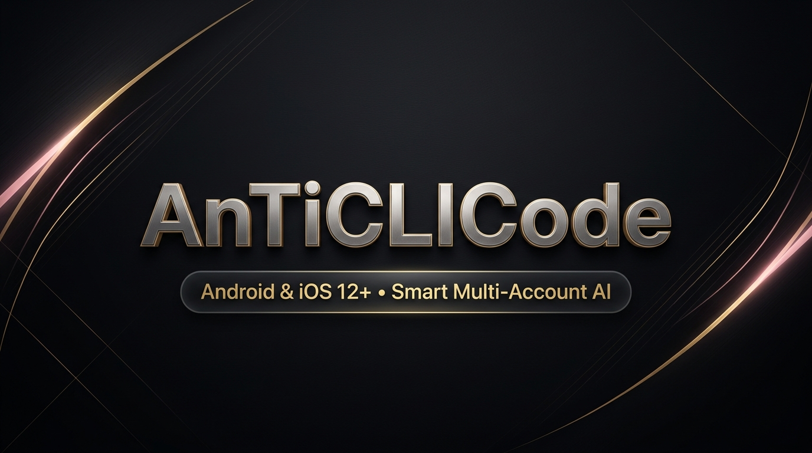
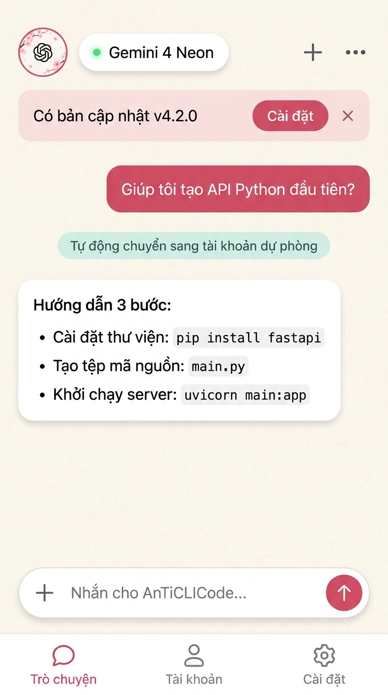
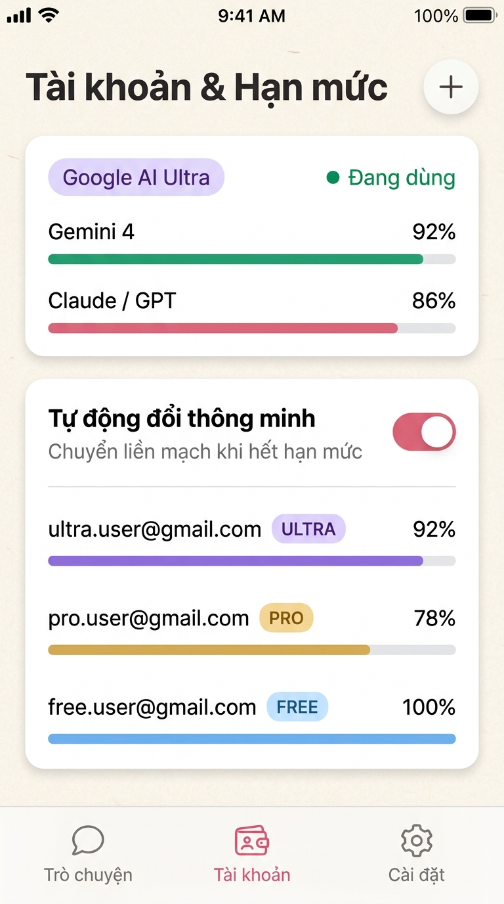
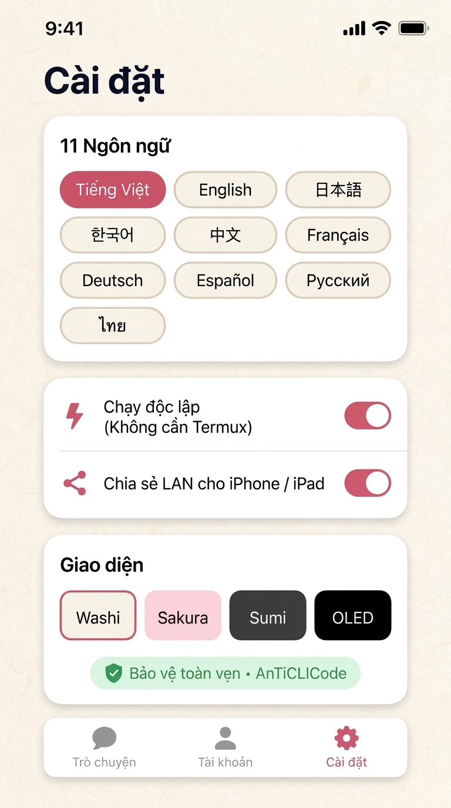
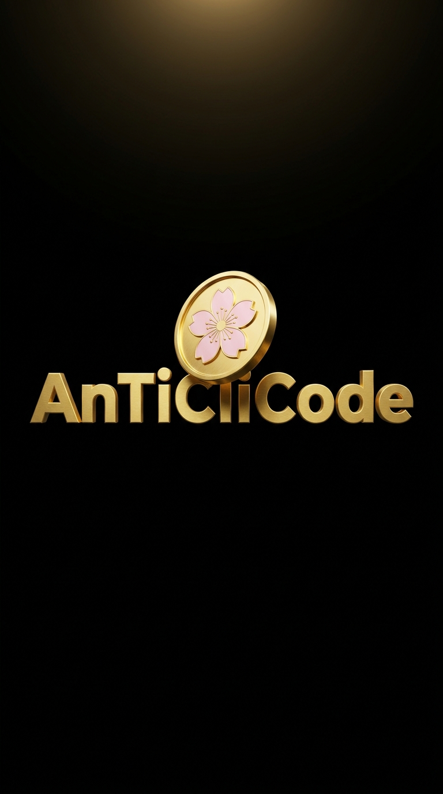

 

# ⚡ AnTiCLICode — Trợ Lý AI & Lập Trình Di Động Không Ngắt Quãng

### **Cài đặt 1 chạm cho cả Android & iPhone (từ iPhone 6 iOS 12+) • Tự động đổi tài khoản thông minh 24/7 • Không cần Termux**

  
  

  
  
  
  

**[⬇️ Tải nhanh Android & iPhone](#-tải-ngay-phiên-bản-mới-nhất-v420)** • **[📸 Xem giao diện](#-trải-nghiệm-giao-diện-thực-tế)** • **[🚀 Tính năng nổi bật](#-tính-năng-khiến-anticlicode-khác-biệt)** • **[🍎 Hướng dẫn cài iPhone](#-cài-đặt-cho-iphone--ipad-ios-120--ios-18)**

---

## 🎯 Tại sao bạn nên cài ngay AnTiCLICode?

Bạn mới bắt đầu khám phá AI nhưng ngại cài dòng lệnh rườm rà? Hay bạn đang trò chuyện/viết code hăng say thì bị chặn vì **hết hạn mức (quota)** giữa chừng?

**AnTiCLICode** sinh ra để giải quyết triệt để cả hai vấn đề đó ngay trên chiếc điện thoại của bạn:

| Điểm nổi bật | Trải nghiệm thực tế với **AnTiCLICode** |
| :--- | :--- |
| 🌱 **Thân thiện tuyệt đối cho người mới** | Giao diện tiếng Việt tinh gọn chỉ **3 tab đáy** (`Trò chuyện` • `Tài khoản` • `Cài đặt`). Mở lên là hỏi AI, học tập, dịch thuật, phân tích ảnh và viết code ngay — **không cần biết dòng lệnh**. |
| 🔄 **Tự động đổi tài khoản không ngắt quãng** | Thêm nhiều tài khoản Google (**Ultra / Pro / Free**). Khi một tài khoản hoặc nhóm mô hình chạm trần, AnTiCLICode tự chuyển sang mô hình/tài khoản dự phòng trong tích tắc mà **giữ nguyên mạch trò chuyện**! |
| 🤖 **Android chạy độc lập 100%** | Chỉ cần cài duy nhất tệp **`.apk`** — **KHÔNG cần cài Termux**. Bấm 1 chạm tải lõi AI độc lập là dùng ngay. |
| 🍎 **Hỗ trợ cả iPhone / iPad từ iOS 12.0+** | Phát hành chính thức tệp **`AnTiCLICode-iOS12+.ipa`** chạy mượt từ **iPhone 6 (iOS 12.5.7)** đến **iPhone 16 Pro (iOS 18+)**, kèm chế độ chia sẻ LAN 1 chạm từ Android sang iPhone! |

---

## 📥 Tải ngay phiên bản mới nhất (`v4.2.0 — Build 22`)

| Nền tảng | Tệp cài đặt chính thức | Thiết bị hỗ trợ | Kích thước | Tải trực tiếp |
| :--- | :--- | :--- | :---: | :---: |
| **🤖 Android** | `antigravity-code-mobile.apk` | Android 7.0+ (ARM64) — *Độc lập, không cần Termux* | `9.29 MB` | **[⬇️ Tải APK ngay](https://github.com/sieudich/AnTiCLICode/releases/download/v4.2.0/antigravity-code-mobile.apk)** |
| **🍎 iPhone / iPad** | `AnTiCLICode-iOS12+.ipa` | iOS 12.0 → iOS 18+ *(iPhone 5s, iPhone 6 → iPhone 16 & iPad)* | `16.98 MB` | **[⬇️ Tải IPA ngay](https://github.com/sieudich/AnTiCLICode/releases/download/v4.2.0/AnTiCLICode-iOS12+.ipa)** |

> 💡 **Ghi chú dành cho người dùng iPhone / iPad**: Vì Apple giới hạn chạy tiến trình CLI ngầm trong sandbox iOS, ứng dụng **AnTiCLICode iOS** kết nối siêu tốc qua Wi-Fi LAN (hoặc Tailscale/Tunnel) tới cầu nối của **AnTiCLICode Android** (bật 1 công tắc *Chia sẻ LAN* trong Cài đặt) hoặc máy tính/VPS của bạn.

---

## 📸 Trải nghiệm giao diện thực tế

| 💬 Trò chuyện & Banner OTA cố định | 🔄 Đa tài khoản & Tự đổi thông minh | 🌐 11 Ngôn ngữ & Chạy độc lập | ✨ Intro 3D bún đồng xu vàng |
| :---: | :---: | :---: | :---: |
|  |  |  |  |

---

## 🚀 Tính năng khiến AnTiCLICode khác biệt

### 1. 🔄 Động cơ xoay vòng đa tài khoản thông minh (Zero-Interruption)
- **Tự ưu tiên gói mạnh nhất**: Luôn ưu tiên tài khoản **Ultra / Pro** trước **Free**; tự động bảo toàn đúng mô hình Pro và mức suy luận yêu thích khi luân chuyển giữa các tài khoản trả phí.
- **Tự tối ưu cho tài khoản Free**: Tự lọc hiển thị chính xác các mô hình khả dụng và chọn mức suy luận mạnh nhất theo thứ tự **Gemini → Claude → GPT**.
- **Nhận diện chuẩn lỗi máy chủ**: Phân biệt rõ lỗi quá tải tạm thời (**HTTP 503**) với hết hạn mức tài khoản (**HTTP 429**), chống đánh dấu nhầm và chống lặp qua lại vô ích.
- **Bền bỉ khi chat tác vụ dài**: Chủ động gia hạn phiên OAuth dưới nền trước khi hết hạn 1 giờ + bộ canh chống treo (**Anti-Stall Watchdog**) tự nối lại ngay nếu đổi Wi-Fi / 4G.

### 2. ⚡ Chạy độc lập trên Android + Đồng bộ 1 chạm sang iPhone / iPad
- **Android**: Đóng gói gọn nhẹ lõi native **Rust ARM64**, tải lõi AI 1 chạm trong app — không phụ thuộc Termux.
- **iPhone / iPad (iOS 12.0+)**: Viết thuần **UIKit + WKWebView + WebSocket RFC 6455 trên TCP Stream** giúp chạy mượt mà ngay cả trên **iPhone 6 chạy iOS 12.5.7** cũng như các dòng iPhone mới nhất.

### 3. 🌐 11 Ngôn ngữ giao diện & Đa phong cách cá nhân hóa
- Chuyển ngôn ngữ tức thì (**offline < 5ms**):
  > 🇻🇳 Tiếng Việt • 🇺🇸 English • 🇯🇵 日本語 • 🇰🇷 한국어 • 🇨🇳 简体中文 • 🇹🇼 繁體中文 • 🇫🇷 Français • 🇩🇪 Deutsch • 🇪🇸 Español • 🇷🇺 Русский • 🇹🇭 ไทย
- **4 chủ đề thiết kế thủ công mượt 60fps**: `Washi` (giấy kem dịu mắt), `Sakura` (hoa anh đào), `Sumi` (mực tối), `OLED` (đen sâu tiết kiệm pin) — kèm hỗ trợ hình nền ảnh/video động, khung avatar động và tùy chỉnh tên hiển thị.

### 4. 🔔 Thông báo cập nhật OTA cố định & Trợ thủ lập trình toàn năng
- **Banner OTA không bao giờ bỏ lỡ**: Ngay khi có bản cập nhật mới hơn, thanh thông báo hiển thị trực tiếp ở màn hình chính và **không tự biến mất** cho tới khi bạn bấm dấu `×`.
- **Bộ công cụ làm việc thực chiến**: Đính kèm nhiều ảnh/tệp, trình xem & cắt ảnh tích hợp, chế độ lập kế hoạch (`/plan`), tăng tốc tư duy sâu (`/boost`), trình duyệt AI trực tiếp (`/browser`), hệ thống kỹ năng (`Skills`) và quản lý lịch sử chat theo thư mục dự án.

---

## 🛠️ Hướng dẫn cài đặt siêu tốc

### 🤖 Cài đặt cho Android (3 bước — 1 phút xong ngay)
1. **Tải tệp APK chính thức**: 👉 **[antigravity-code-mobile.apk (v4.2.0 — 9.29 MB)](https://github.com/sieudich/AnTiCLICode/releases/download/v4.2.0/antigravity-code-mobile.apk)**
2. Mở tệp vừa tải → cho phép **Cài đặt từ nguồn này** (nếu máy hỏi) → bấm **Cài đặt**.
3. Mở **AnTiCLICode** → chọn **Tải lõi AI độc lập ngay** (chỉ 1 lần đầu) → đăng nhập tài khoản Google tại tab **Tài khoản** và bắt đầu sử dụng!

---

### 🍎 Cài đặt cho iPhone / iPad (iOS 12.0 → iOS 18+)

#### ✅ Cách 1: Cài app Native `AnTiCLICode-iOS12+.ipa` KHÔNG cần Jailbreak *(Khuyên dùng)*
Tương thích hoàn hảo từ **iPhone 6 (iOS 12.5.7)** đến **iPhone 16 (iOS 18+)** qua **Sideloadly**, **AltStore**, **ESign** hoặc **Scarlet**:

1. Tải tệp **[AnTiCLICode-iOS12+.ipa (16.98 MB)](https://github.com/sieudich/AnTiCLICode/releases/download/v4.2.0/AnTiCLICode-iOS12+.ipa)** về máy tính (Windows / Mac) hoặc trực tiếp lên iPhone (nếu dùng ESign / Scarlet).
2. Trên máy tính, mở **[Sideloadly](https://sideloadly.io/)** (miễn phí, hỗ trợ chuẩn cả iOS 12.5.7) → cắm cáp nối iPhone → kéo thả tệp `AnTiCLICode-iOS12+.ipa` vào → nhập Apple ID bất kỳ → bấm **Start**.
3. Trên iPhone vào **Cài đặt → Cài đặt chung → Quản lý thiết bị / VPN & Thiết bị** → chọn email Apple ID vừa ký → bấm **Tin cậy (Trust)**.
4. Mở **AnTiCLICode** ngoài màn hình chính → bật **Chia sẻ LAN** trên máy Android (hoặc chạy cầu nối trên PC) → nhập **IP LAN** (ví dụ `192.168.1.10`), cổng `8787` và **Token** là kết nối mượt ngay!

#### 🔓 Cách 2: Máy đã Jailbreak hoặc có TrollStore *(Cài vĩnh viễn — không hết hạn 7 ngày)*
1. Tải trực tiếp **[AnTiCLICode-iOS12+.ipa](https://github.com/sieudich/AnTiCLICode/releases/download/v4.2.0/AnTiCLICode-iOS12+.ipa)** bằng Safari trên iPhone.
2. Mở tệp bằng **TrollStore** (iOS 14.0–17.0) hoặc **Filza File Manager** (đã cài **AppSync Unified** trên iOS 12–16) → bấm **Cài đặt (Install)** là dùng vĩnh viễn!

#### ⚡ Cách 3: Dùng ngay sau 30 giây KHÔNG cần máy tính (Safari PWA)
1. Bật **Chia sẻ LAN cho iPhone / iPad** trong tab *Cài đặt* của **AnTiCLICode** trên Android.
2. Mở đường dẫn hiển thị (ví dụ `http://192.168.1.10:8787/`) bằng **Safari** trên iPhone.
3. Chạm nút **Chia sẻ (↑)** → chọn **Thêm vào MH chính (Add to Home Screen)** → mở ứng dụng **AnTiCLICode** toàn màn hình như app gốc!

---

## 🔐 Xác minh toàn vẹn tệp tải về (SHA-256)

| Tệp phát hành | Nền tảng | Phiên bản | Kích thước | Mã kiểm tra SHA-256 |
| :--- | :---: | :---: | :---: | :--- |
| [`antigravity-code-mobile.apk`](https://github.com/sieudich/AnTiCLICode/releases/download/v4.2.0/antigravity-code-mobile.apk) | Android 7.0+ (ARM64) | `v4.2.0 (Build 22)` | `9.29 MB` | `F55CF35E5D3548C1CDEB2BCE8098FCFB894E25D59F4491B280CEB6B5EA95B435` |
| [`AnTiCLICode-iOS12+.ipa`](https://github.com/sieudich/AnTiCLICode/releases/download/v4.2.0/AnTiCLICode-iOS12+.ipa) | iOS 12.0+ (ARM64) | `v4.2.0 (Build 22)` | `16.98 MB` | `B7775C85AAC8AE15372F31E0C0379759EF71AC08E7ED97D5840A7E74031BA9B1` |

Tệp tổng hợp mã kiểm tra: [`SHA256SUMS.txt`](https://github.com/sieudich/AnTiCLICode/releases/download/v4.2.0/SHA256SUMS.txt)

---

## 🛡 Bản quyền & Bảo vệ thành phẩm

> **⚠️ LƯU Ý BẢN QUYỀN (PROPRIETARY CLOSED-SOURCE — ALL RIGHTS RESERVED)**
>
> Kho lưu trữ này **chỉ phát hành tệp cài đặt chính thức (`.apk` cho Android & `.ipa` cho iPhone/iPad)** dành cho người dùng cuối — **KHÔNG công khai mã nguồn**.
>
> - Tệp Android APK được bảo vệ bởi **kho mã hóa ChaCha20-Poly1305 gắn chặt với chữ ký số SHA-256 gốc**, lõi kiểm tra toàn vẹn thời gian thực chống sửa đổi / đóng gói lại / gắn debugger / hook (Frida, Xposed, LSPosed, MT Manager...).
> - **Nghiêm cấm tuyệt đối** hành vi sao chép, phân phối bản chỉnh sửa, dịch ngược APK/IPA, bóc tách tài nguyên hoặc sử dụng AI / công cụ tự động để sao chép, tái tạo lại **AnTiCLICode**. Xem chi tiết tại [LICENSE](LICENSE).

---

  Phát triển bởi <b>AnTiCLICode • Kanami × Kanika</b> • Bảo lưu mọi quyền (All Rights Reserved)

